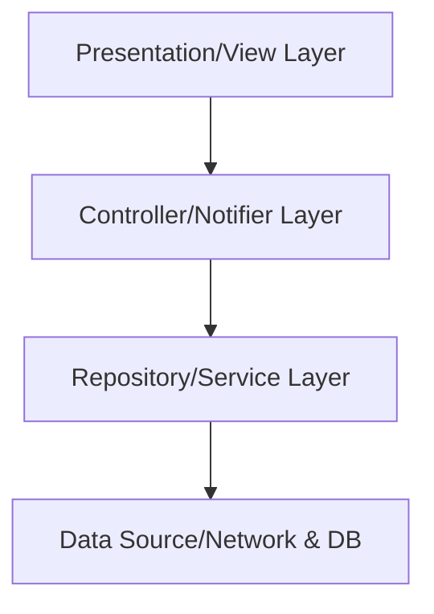

# Project Overview & Architecture Guide

This document provides a high-level overview of the Base App's architecture, directory structure, and key development workflows. It is optimized for both human developers and AI agents to quickly understand the project's layout and dependencies.

## Architecture Pattern

The codebase is built on **Flutter + Riverpod 3.x** and adheres to a modified clean architecture layout featuring three main layers within `lib/src/`:



1. **Presentation (View) Layer**: Handles rendering widgets, screen flows, and user inputs. (Located in `lib/src/view/`).
2. **Controller (Notifier) Layer**: Manages page state using Riverpod's `AsyncNotifier` or `Notifier`. (Located in `lib/src/model/` alongside entities).
3. **Repository/Service Layer**: Communicates with external APIs (HTTP/WebSocket) and local databases.

## Directory Structure

Here is a breakdown of the key directories in the project:

- `lib/`: Main entry points.
  - `lib/main.dart`: App startup configuration.
  - `lib/src/app.dart`: Main application initialization, provider services start, and theme setup.
  - `lib/src/tab_scaffold.dart`: Root tab structure (Home, Notifications, Settings, Account).
  - `lib/src/model/`: Domain models and business logic controllers.
    - `account/`: Logged-in user information and repositories.
    - `auth/`: OAuth credential management and session state.
    - `common/`: Global IDs, sound mock, and preloaded configurations.
    - `settings/`: General preferences (locale, theme, brightness).
  - `lib/src/view/`: Screen layouts and views.
    - `auth/`: Login screens.
    - `home/`: Home screen dashboard.
    - `message/`: Messaging/Inbox UI.
    - `settings/`: App configuration screens.
  - `lib/src/widgets/`: Reusable presentation UI elements (dialogs, shimmer, buttons, dividers).
  - `lib/src/utils/`: Common utilities (responsive screens, json serialization, dynamic colors, navigation observers).

## Key Developer Commands

All generated files (`.freezed.dart`, `.g.dart`) are generated using `build_runner`.

```bash
# Get dependencies
flutter pub get

# Generate code files (one-time build)
dart run build_runner build

# Run code generator in watch mode
dart run build_runner watch

# Run static analysis
flutter analyze
```
