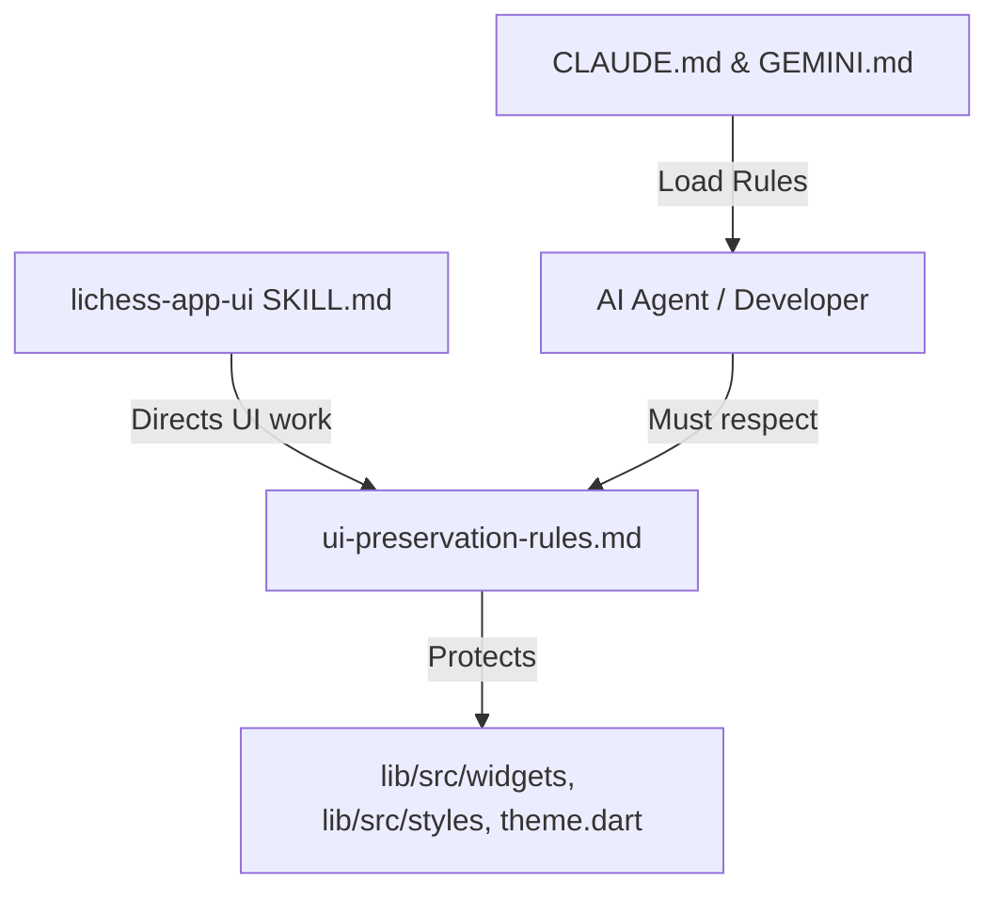

# Phase 1: Define UI Style Preservation Rules

## Context Links
- [Brainstormer Report](file:///Users/devj666/Documents/WorkPlace/Personal/mobile-devj666/plans/reports/brainstormer-260626-2341-preserve-ui-style-rules.md)
- [Lichess App UI Skill](file:///Users/devj666/Documents/WorkPlace/Personal/mobile-devj666/.agent/skills/lichess-app-ui/SKILL.md)
- [CLAUDE.md](file:///Users/devj666/Documents/WorkPlace/Personal/mobile-devj666/CLAUDE.md)

## Overview
- **Priority**: High
- **Status**: Proposed
- **Description**: Add strict rules for developers and AI agents to safeguard the UI layout and style from regression when they fork or use `nf_base`.

## Key Insights
- Modifying styles in Flutter projects is easy to do incorrectly (e.g. changing root variables instead of extension variables).
- Specifying exactly which directories/files are **READ-ONLY** vs **CUSTOMIZABLE** is the most effective way to prevent UI changes.
- Placing these rules in both `CLAUDE.md`, `GEMINI.md` and the skill reference ensures that all developers and agents are forced to follow them.

## Requirements
- Create `references/ui-preservation-rules.md` inside `lichess-app-ui` skill.
- Link this reference in `SKILL.md`.
- Inject UI style preservation guidelines into `CLAUDE.md` and a new `GEMINI.md` file at the project root.
- Ensure all files are under 200 lines where applicable (except `CLAUDE.md`/`GEMINI.md` which are config files).

## Architecture
This phase is non-functional and configuration-based, establishing guidelines and restrictions for codebase evolution.

## Related Code Files
- [NEW] [ui-preservation-rules.md](file:///Users/devj666/Documents/WorkPlace/Personal/mobile-devj666/.agent/skills/lichess-app-ui/references/ui-preservation-rules.md)
- [MODIFY] [SKILL.md](file:///Users/devj666/Documents/WorkPlace/Personal/mobile-devj666/.agent/skills/lichess-app-ui/SKILL.md)
- [MODIFY] [CLAUDE.md](file:///Users/devj666/Documents/WorkPlace/Personal/mobile-devj666/CLAUDE.md)
- [NEW] [GEMINI.md](file:///Users/devj666/Documents/WorkPlace/Personal/mobile-devj666/GEMINI.md)

## Implementation Steps

### Step 1: Create `references/ui-preservation-rules.md`
- Create the file and specify:
  - Allowed customizations: Changing `brandSeedColor` in `theme.dart`, changing text labels, deep-link targets, images.
  - Prohibited changes: No editing of `lib/src/styles/`, no raw widgets instead of platform-specific widgets.
  - Theme extension integrity.

### Step 2: Link `ui-preservation-rules.md` in `SKILL.md`
- Edit `SKILL.md` to add the reference to the list.

### Step 3: Add Preservation Rules section to `CLAUDE.md`
- Add a new section detailing the rules for preservation of UI styles.

### Step 4: Create `GEMINI.md` at root
- Create `GEMINI.md` defining project guidelines, including UI preservation rules.

## Todo List
- [ ] Create `ui-preservation-rules.md`
- [ ] Update `SKILL.md`
- [ ] Modify `CLAUDE.md`
- [ ] Create `GEMINI.md`

## Success Criteria
- The rule configuration files are correctly written.
- All guidelines are under 150 lines (references).
- All AI workflows automatically pick up UI preservation constraints.

## Risk Assessment
- *Risk*: Developers might bypass `CLAUDE.md` or `GEMINI.md`.
- *Mitigation*: The skill checks will enforce this when used, and we document it clearly in `README.md`.

## Security Considerations
None.

## Next Steps
Obtain user approval, then execute the steps.
