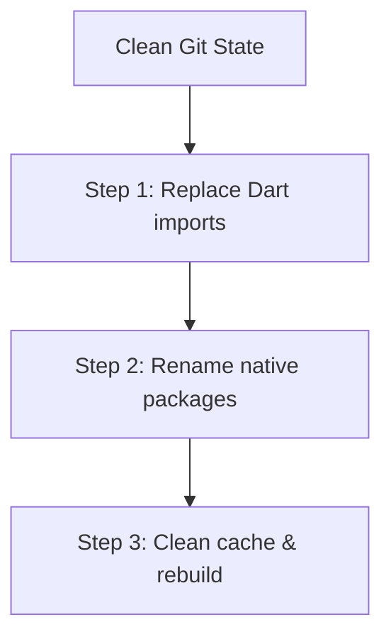

# Brainstorming Report: Renaming the Project

- **Date**: 2026-06-25
- **Task**: Rename Flutter package, application IDs, and display names
- **Status**: Complete

---

## 1. Problem Statement & Requirements
The goal is to rename the codebase from `lichess_mobile` (and its native package ID `org.lichess.mobileV2`) to a new, generic, or product-specific name.

### Requirements:
1. Rename the **Dart package name** in `pubspec.yaml` and update all Dart `import 'package:lichess_mobile/...'` statements.
2. Rename the **Android Package Name / Application ID** (currently `org.lichess.mobileV2`) and update the Android folder directory structure.
3. Rename the **iOS Bundle Identifier** (currently `org.lichess.mobileV2`) and product configurations.
4. Rename the **App Display Name** (for the launcher icons on the home screen).
5. Clean up cache and rebuild (`build_runner` and gradle/xcode targets).

---

## 2. Evaluated Approaches

### Option A: Pure Manual Search & Replace
- **How it works**: Manually run global search/replace in the IDE/shell for package name/ID and manually relocate native directory paths (e.g. `android/app/src/main/kotlin/org/lichess/mobileV2/`).
- **Pros**:
  - Zero external tool dependencies.
- **Cons**:
  - Extremely error-prone; missing a file will break builds.
  - Relocating Kotlin directories and renaming files like `.pbxproj` keys manually is highly tedious.

### Option B: Automated Renaming Packages (e.g. `change_app_package_name` / `rename`)
- **How it works**: Run pub packages like `change_app_package_name` or `rename` to automatically update native files and folder hierarchies.
- **Pros**:
  - Handles native folder restructuring (Kotlin/Java) and plist updates safely.
- **Cons**:
  - These tools only change native IDs, NOT the Flutter Dart package name/imports.

### Option C (Recommended): Hybrid Renaming Strategy
- **How it works**:
  1. Use native commands (e.g., `perl` or `sed` on macOS) to globally replace `lichess_mobile` package name in `pubspec.yaml` and all `.dart` imports.
  2. Use a dedicated native renaming tool like `change_app_package_name` to handle Android application IDs and folder structures.
  3. Manually verify and adjust Xcode bundle IDs and display names.
- **Pros**:
  - Combines swift automatic folder relocation for Android with safe global Dart import updates.
- **Cons**:
  - Requires clean git index to revert easily if build fails.

---

## 3. Implementation Steps & Risks

### Risk Assessment:
- **Xcode Target breaking**: The project uses targets like `LichessWidgets`. Changing product names might cause entitlements to break if not matching.
- **build_runner Generation**: Code gen (`.g.dart`/`.freezed.dart`) contains package paths. Must clean before regenerating.

### Next Steps:
1. Prompt user for the new project name (e.g., `app_base`) and native package ID (e.g., `com.company.app`).
2. Implement the hybrid script/steps on confirmation.
